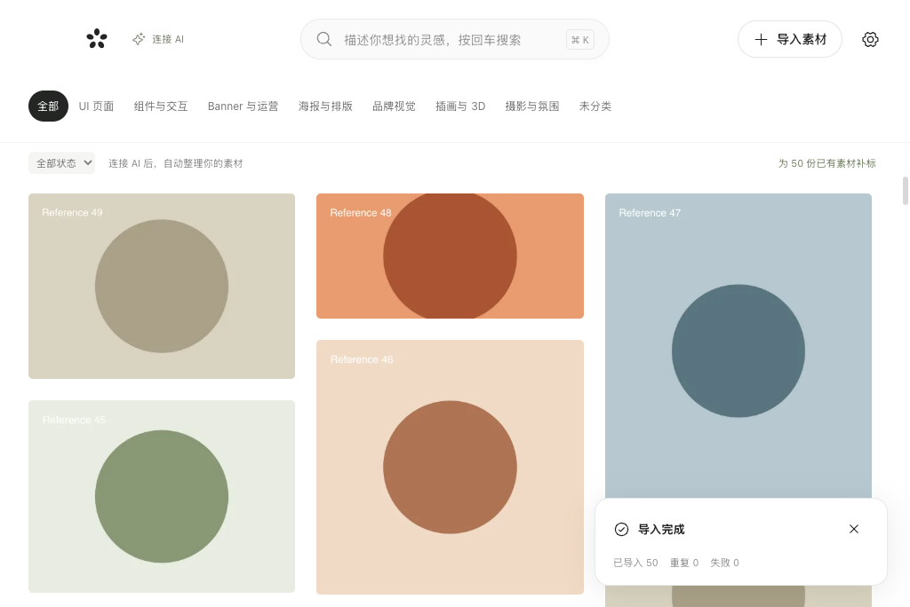

# 灵感库

为个人设计工作打造的本地 macOS 视觉素材库。已实现本地图片收藏、AI 自动整理与自然语言搜索。

## 预览



截图来自自动化桌面测试，只包含程序生成的几何图形，没有个人收藏素材。

## 使用

从源码构建并打开应用后，点击「创建我的素材库」。默认目录是 `~/Pictures/灵感库`，也可选择其他空目录。

1. 点击「导入素材」选择图片或整个目录，或者直接将文件/文件夹拖进应用。
2. 在设置中连接 AI，新图自动分析；已有素材点击「补标已有图片」。详情支持备注与纠正信息。
3. 在搜索框描述需求并按回车，AI 根据设计分析找图。可以切换本地关键词模式，或叠加分类与分析状态筛选。
4. 详情页的文件夹按钮在 Finder 中定位原文件；设置页可以打开整个素材库。

快捷键：`⌘K` 聚焦搜索；详情中的 `←` / `→` 切换图片；`Esc` 返回。离开详情或切换图片前会保存修改，校验失败时留在当前详情并提示原因。

## 文件在哪里

```text
~/Pictures/灵感库/
├── 原图/YYYY-MM/可读文件名-短编号.png
└── .library/
    ├── library.sqlite
    ├── thumbnails/
    └── staging/
```

导入是复制，来源文件不受影响。按 SHA-256 判断重复内容，同名不同内容的文件可同时保留。原文件不被压缩或重写；缩略图单独生成。数据库使用相对路径，允许关闭应用后整体复制目录，再通过「打开已有素材库」打开。

备份时请先完全退出应用，再复制整个素材库（包括隐藏的 `.library`）。请通过应用修改分类、标题与标签；直接在 Finder 重命名/移动单个原文件不会自动更新数据库。应用关闭窗口后仍驻留，可从 Dock 再次打开；`⌘Q` 退出会等待当前导入完成。强制退出后会清理未完成文件，重新导入原目录即可补齐，已有内容会自动去重。

当前支持 JPEG、PNG、WebP、GIF。GIF 预览保留动画，缩略图使用首帧；复制图片到剪贴板为静态图片，最长边限制为 4096 px，原文件不变。当前已接入 AI；视频分析、浏览器扩展和云同步尚未实现，后续路线见 [ROADMAP.md](ROADMAP.md)。

## 开发与构建

环境：Node 22.22+、pnpm 11、macOS Apple Silicon。Electron 44 内置 Node SQLite，Sharp 在独立工作线程内处理图片；前端不直接访问文件系统。开发时用本地 Vite，打包版直接读取本地文件，不依赖开发服务器。

```sh
pnpm install
pnpm dev
pnpm typecheck
pnpm test
pnpm test:desktop
pnpm package:mac
```

打包产物为 `release/mac-arm64/灵感库.app`，无 Developer ID 签名及公证，用于本地开发与验证。`pnpm package:mac` 是脚本名称；不要用 pnpm 自带的 `pack` 命令代替。

```sh
PACKAGED_APP="$PWD/release/mac-arm64/灵感库.app/Contents/MacOS/灵感库" pnpm exec playwright test
```

测试使用系统临时目录，不会创建或导入到个人素材库。可通过 `LIBRARY_USER_DATA` 和 `LIBRARY_ROOT` 指定隔离的应用设置与已有测试素材库；正常使用不需设置环境变量。界面测试截图输出到 `test-results`，不打包到应用中。

## 架构

- React 提供图库、搜索面板、详情和设置；使用按图片尺寸排布的虚拟瀑布流。
- Electron 主进程负责窗口、原生文件选择器、Finder、剪贴板和类型明确的 preload IPC。
- `LibraryService` 在独立 Worker 中管理 SQLite、素材查询、收藏集和导入队列，后续可以从这里拆出独立采集与 AI 服务。
- 图片通过受限的 `library://asset/{id}/{kind}` 协议读取，前端不能传任意文件路径。

测试范围及实际验证结果见 [VALIDATION.md](VALIDATION.md)。

## 0.2：AI 自动管理

目前采用「收藏 → AI 自动分析 → 搜索找回」流程，收藏集界面已移除，原有收藏集数据保留。

在设置中填写 Base URL、模型名和 API Key，保存并测试图片识别。开启 AI 后新图自动分析；「补标已有图片」处理历史素材。支持 Responses 或 Chat Completions 的 OpenAI 兼容接口，要求支持图片和严格 JSON Schema。API Key 使用 macOS 密钥服务加密保存在本机，不写进素材库或项目文件。

AI 生成分类、内容、风格、情绪、构图、字体、材质、光影、代表色、用途、行业、OCR、署名依据、风格联想、标签和视觉提示词。颜色是视觉估计；来源不明的作者留空；GIF 只分析首帧。详情中的「纠正信息或补充标签」可覆盖分类判断；手动备注和标签不被重新分析覆盖。

智能搜索使用同一模型拆解查询，本地召回最多 70 个候选，再交给模型排序，不依赖 embedding。它基于已保存的文字分析，不是直接图像向量检索。按回车才发起请求；输入过程中不调用模型。相同查询缓存到素材或模型配置变化为止。可切换「本地关键词」离线搜索 AI 描述、标签、文件名与备注。

分析只发送最长边 1600 px 的 JPEG 预览、文件名、备注及手动标签；智能搜索发送查询和候选的文字分析。原图留在本地，不自动访问来源网址。新图自动分析可关闭，队列支持暂停、恢复和失败重试。每张分析最多尝试 3 次（仅暂时故障），每次请求超时 120 秒。服务故障会暂停队列；重新分析失败时保留上一次有效结果。

模型 token 用量按实际返回统计。第三方代理价格以服务商为准，填写每百万 token 的输入/输出美元单价后才显示估算。中断请求可能已收费，但未返回用量的请求不会出现在此统计中。旧图库升级至 schema v2，原文件不变。

官方接口参考：[图片输入](https://developers.openai.com/api/docs/guides/images-vision)、[结构化输出](https://developers.openai.com/api/docs/guides/structured-outputs)。
